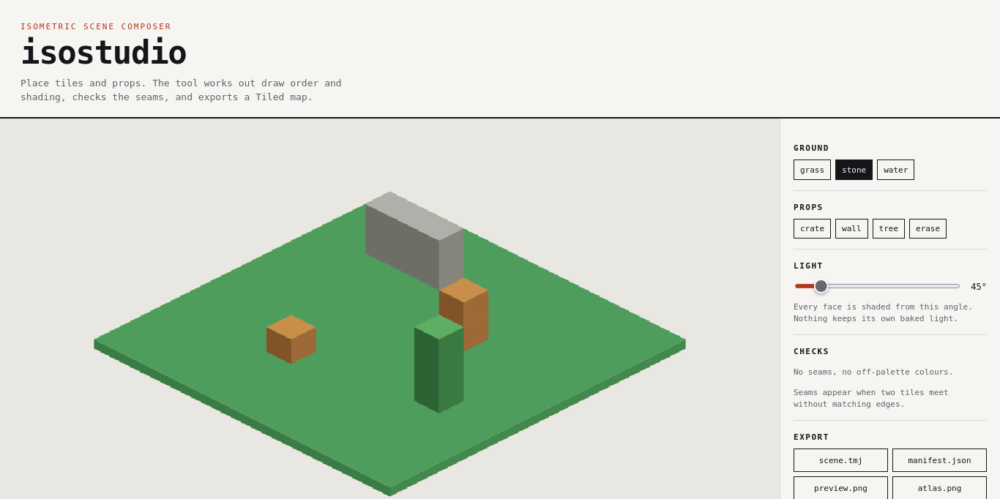

# isostudio

An isometric scene composer. Place tiles and props, and the tool works out draw order and shading, checks the seams, and exports a map your editor can open.



Drawing pixels is solved. Aseprite, Piskel and a dozen generators cover it. What still costs artists hours is everything after the drawing: working out which sprite covers which, keeping one light across a whole scene, catching a tile that will not join its neighbour, and getting the result into an engine without hand-managing layers. isostudio does that part.

Place a crate behind a wall and it stays behind, even when the crate is taller. Move the light and every face in the scene changes together. Paint stone next to grass and the checks panel names the seam and both colours, because those two tiles need a transition between them. Export and you get a Tiled map whose objects carry their grid position, footprint and height as properties.

## Run it

```bash
git clone https://github.com/TamiloreO/isostudio.git
cd isostudio
python3 -m http.server 8080
```

Open http://localhost:8080/demo/.

## Tests

```bash
npm test
```

Twenty-three checks, no dependencies: projection round trips, the depth sort produces an order with no violations, the light angle decides which face leads, palette distance and drift, seam detection, and the exported map surviving a JSON round trip.

## Export

`scene.tmj` plus `atlas.png` open in Tiled as an isometric map. `manifest.json` keeps the document itself: grid, light angle, palette, per-prop footprint and height. The point of the Tiled export is that anyone can check the tool's output without trusting the tool.

## Limits

Props are boxes in this version, not imported sprites. There are no transition tiles yet, which is why painting stone against grass reports seams rather than solving them. No animation, no undo, and the atlas export only covers the ground tiles.

## Licence

MIT, see [LICENSE](LICENSE).
